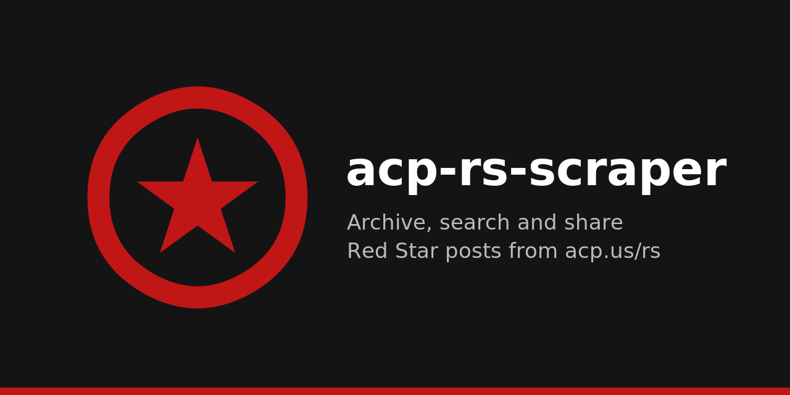
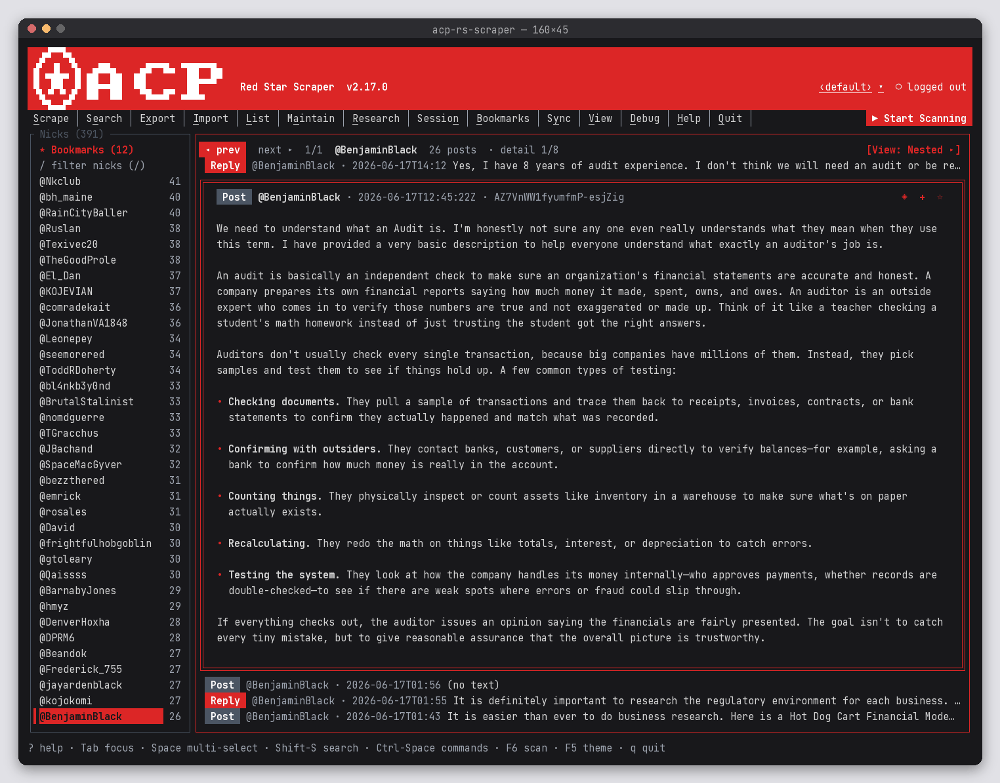
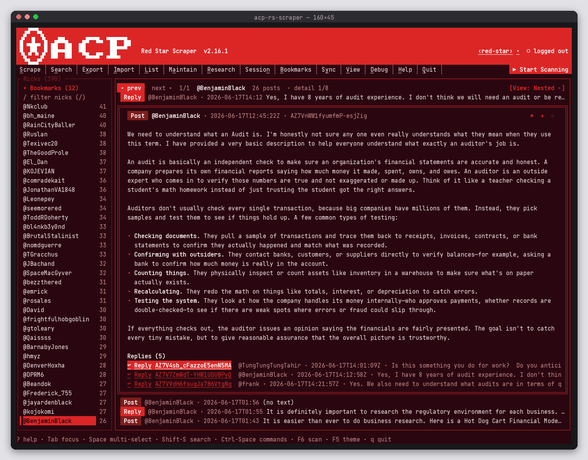
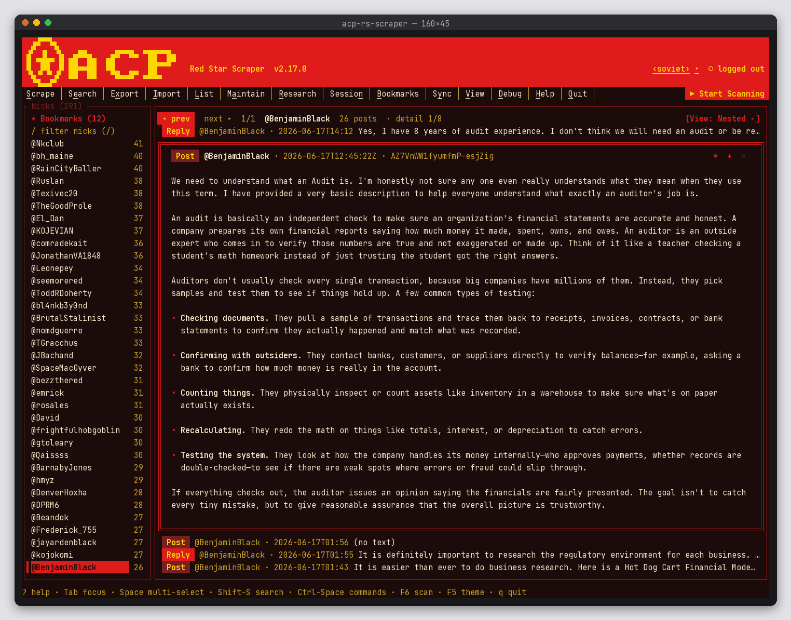
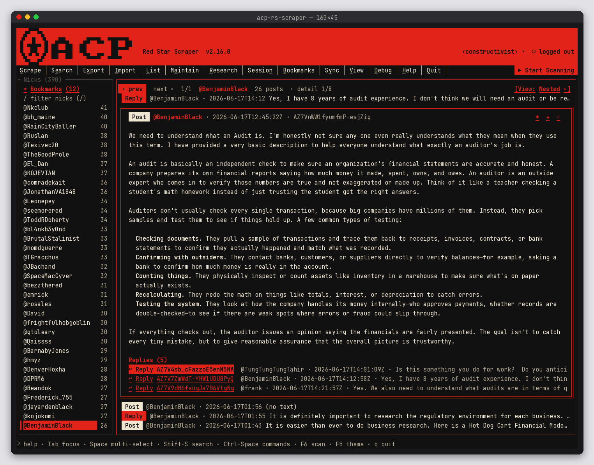
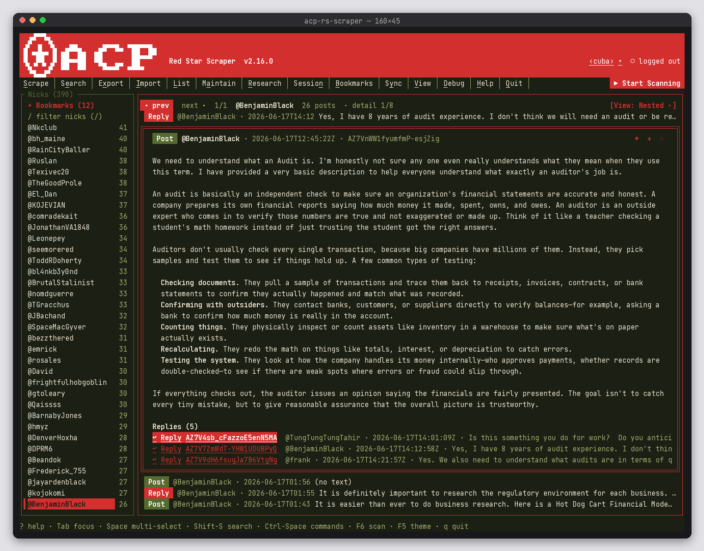
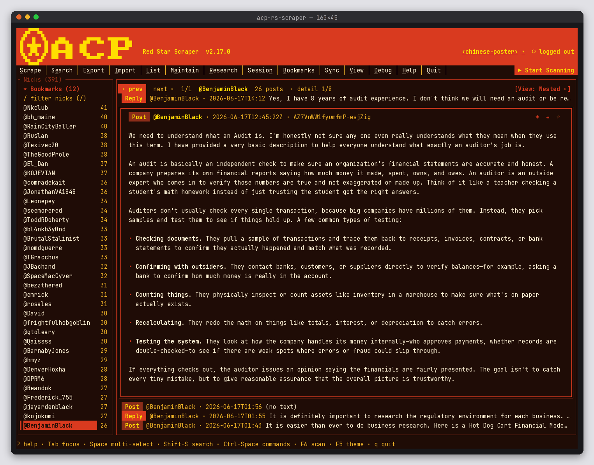
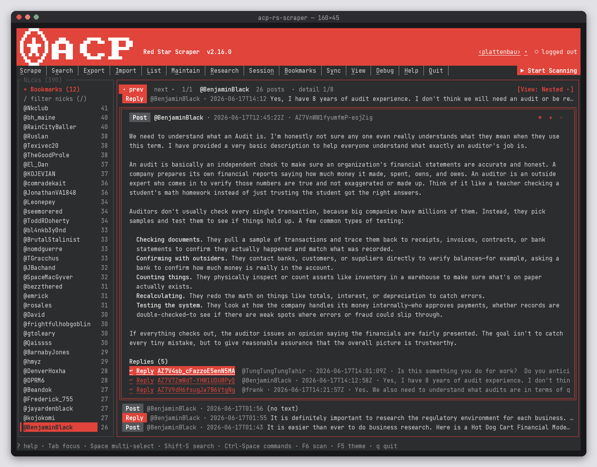
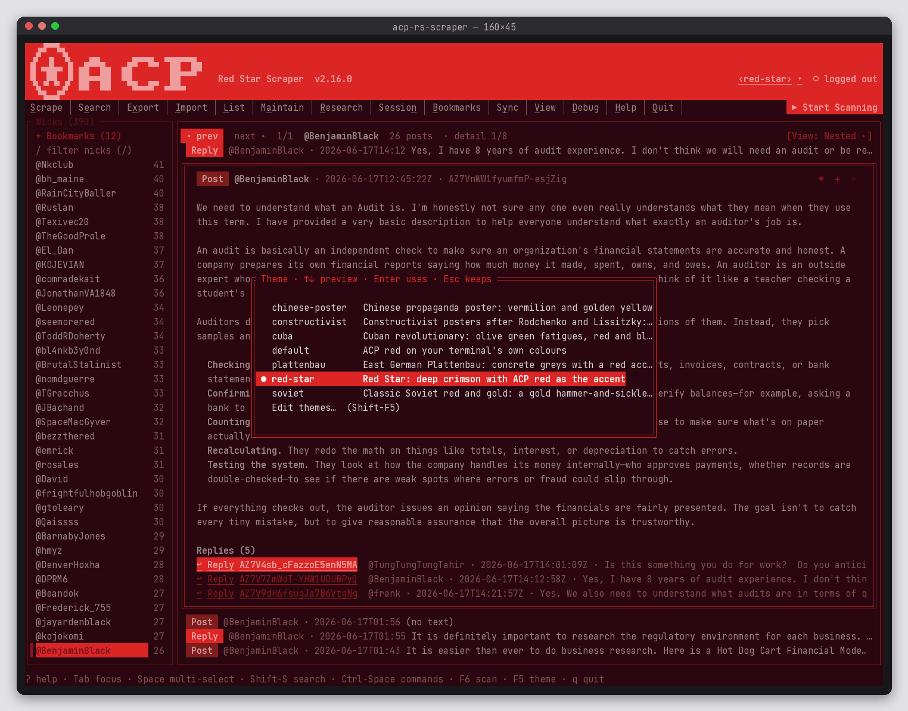
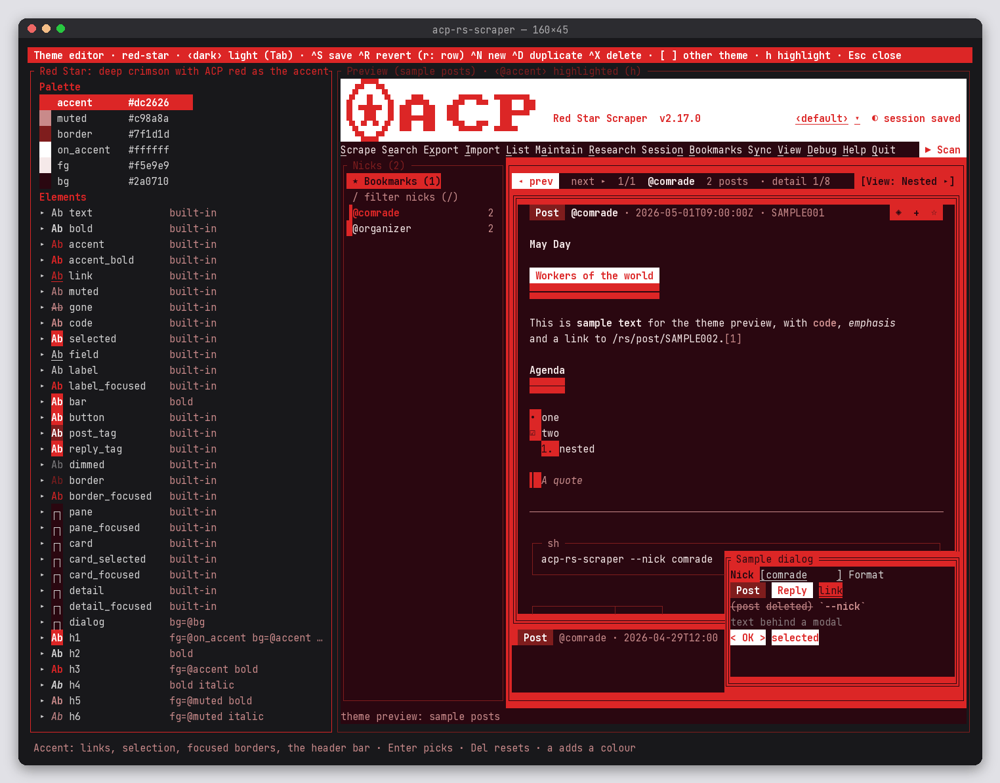

**Current version: 3.3.1** · [Changelog](CHANGELOG.md) · License: GPL-3.0-or-later · MSRV: Rust 1.88

# acp-rs-scraper

> **Full usage guide:** [docs/USAGE.md](docs/USAGE.md) · Install/uninstall: [docs/INSTALL.md](docs/INSTALL.md) · API docs: [docs/index.html](docs/index.html)

Rust 2024 terminal app and CLI. Run it with no flags for a terminal UI that browses everything you have scraped; with flags it logs in to https://acp.us/rs (Red Star forum) as Firefox, scrapes all posts by a nick plus the comments on them, and stores them in SQLite.

## Breaking changes in 3.0.0

3.0.0 encrypts the local database and requires a password of at least 8 characters that passes a strength check. A 2.x install does not.

- **What breaks.** Startup will not open `~/.acp/ai/data/rs.database` from 2.x. A new database asks for a password before the terminal UI or a headless command uses it. 2.x cannot read a 3.0.0 database, `rs.database.bootstrap`, or a `*.acpbackup`.
- **Migrate.** Copy `~/.acp/ai/data/rs.database` somewhere outside `~/.acp` if you may want 2.x again. Then run `acp-rs-scraper --encrypt-db`. It writes a `*.acpbackup` first, encrypts the file, and removes the plaintext copy only after the encrypted copy matches. The password you set is required the next time the program starts (or set `ACP_PASSWORD` when there is no terminal). A session that has already unlocked the database does not ask again.
- **After encryption.** That password is not the master key. The master key is a 24-word recovery phrase. When encryption finishes on a terminal, the app explains the phrase, the 5 shares (any 3 rebuild it), and how to restore, and it offers to create the phrase then. Show it again later with `acp-rs-scraper --show-phrase` (it asks for the password and can clear the terminal). The same text is in `--help` and in the terminal UI under `?`.
- **Roll back.** Before `--encrypt-db` succeeds, install a 2.x binary and keep using the plaintext file. If the command fails, that file is left in place. After it succeeds, put the copy you saved back over `rs.database`, remove `rs.database.bootstrap`, and run 2.x. `--restore` reads a `*.acpbackup` only in 3.0.0.

The header of the terminal UI shows `v3.3.1`. Details are in [CHANGELOG.md](CHANGELOG.md) and [docs/USAGE.md](docs/USAGE.md).

**3.3.1** stops the elapsed clock in job details once a job finishes, fails, or is cancelled. While the job is running, that line still counts. If the end was not recorded, the line says `unknown`.

**3.3.0** gives this computer a node identity. `acp-rs-scraper --node-init` (after `--identity-init`) creates a key on this machine, has the account master sign it, and prints the peer id and a fingerprint. The header shows `◉` and the node name. `--node-id` prints the same public record. The secret stays in `~/.acp/node/keystore` and is left out of backups.

**3.2.0** moves the account identity, canonical CBOR, and the secret-store interface into the library `acp_rs_node_core`, so a later relay or other app can use them without the terminal UI. Flags, the encrypted database, and a `.acpbackup` file are unchanged. The encoding rules and test vectors are in [docs/PROTOCOL.md](docs/PROTOCOL.md).

**3.1.0** adds a job-details window. Click the status bar or the `⟳` mark in the header, or press Tab until Status is focused and then Enter. It shows the job, what started it, whether it is running, finished, failed or cancelled, when it started, how long it has run, the current stage, and the recent log. Esc closes it. A running job can be cancelled from that window. The password and the database key are not shown. Encrypting the database, backup and restore still use the progress screen that runs before the terminal UI.

## Install

Every install builds from source. You need Rust 1.88 or newer; the installer offers rustup if it's missing or too old.

```sh
git clone https://github.com/m3talsmith/acp-rs-scraper.git
cd acp-rs-scraper
scripts/install.sh          # native package for Arch, Debian, Fedora and their derivatives (asks before sudo)
scripts/install.sh --user   # or install into ~/.local without root
```

Uninstall with `scripts/uninstall.sh` (add `--no-purge` to keep `~/.acp`). See [docs/INSTALL.md](docs/INSTALL.md) for details.

## Usage

```text
Run with no flags (or --tui) for the terminal UI: browse every nick and post in the local database, open post details and the posts they link, search, and start scans, exports and imports from a menu bar. With flags it runs headless: log in to https://acp.us/rs as Firefox, scrape posts (and optionally mentions + profiles) for one or more nicks into a local SQLite database, download attachments, and export JSON/HTML — or work entirely offline with --search / --export / --import.

Usage: acp-rs-scraper [OPTIONS]

Options:
  -h, --help
          Print help (see a summary with '-h')

  -V, --version
          Print version

Mode:
      --latest
          Site feed: Latest tab (/rs/latest). Default — even though the site opens on Trending

      --trending
          Site feed: Trending tab (/rs). Opt-in; incremental early-stop disabled (not chronological)

Reading:
      --top [PERIOD]
          Site-wide Top feed (/rs/top). PERIOD is day, week, month, year or all (default: week). Stored locally; View › Site Top opens it

      --top-replies
          With --top: include replies (the feed's replies filter)

      --eb
          Executive Board feed (/rs/eb). Stored locally; the EB row of the nick bar opens it

      --eb-replies
          With --eb: include replies (the feed's replies filter)

      --explore
          Explore feed (/rs/explore). Stored locally; the Explore row of the nick bar opens it

      --explore-latest
          Explore's Latest tab (/rs/explore/latest)

      --site-search <TEXT>
          Search the site (/rs/explore?q=). The Search modal's Where: Site does this too

      --tag <TAG>
          Tag feed (/rs/tag/TAG). A #tag in a post opens the same view. Stored locally

      --backfill-tags
          Fill post_tags from stored bodies, then re-read threads whose ProseMirror JSON is still empty. --nick / --nicks limit the rows. Does not change stored text

      --sort-thread <ID>
          Re-read a thread after the sort hook (oldest or top) and store scores. s in a thread does this

      --thread-sort <ORDER>
          With --sort-thread: oldest or top. Newest is the site default and sends no hook

      --reposts <ID>
          Reposts of a post (/rs/post/ID/reposts). The post menu (p) › View reposts does this

      --edits <THREAD/POST>
          Edit history (/rs/post/THREAD/POST/edits), shown as a diff. A stored post id works too. The post menu (p) › View edits does this

Interface:
      --tui
          Open the terminal UI (also the default when no other flag is given). Other flags pre-fill it: --nick/--nicks select those nicks, -v/--debug/--enable-logging apply to scans started from it

      --theme <NAME>
          Use this theme (a file in ~/.acp/themes, without .toml) in the terminal UI for this run; ui.theme in preferences.toml sets it for good

      --list-themes
          List the themes in ~/.acp/themes (● marks the one in use; broken files say why) and exit

      --theme-init [<NAME>]
          Download a theme from the acp-rs-scraper repo into ~/.acp/themes and exit: NAME (default: default), one of the shipped themes (default, soviet, constructivist, cuba, red-star, chinese-poster, plattenbau), or all. Never replaces an existing file

      --theme-starter <NAME>
          Write the minimal starter theme (plain terminal colours, no download) as ~/.acp/themes/NAME.toml and exit. Never replaces an existing file

Scraping:
      --scrape
          Scrape headlessly, without the terminal UI (what a bare invocation did before 2.0). Asks for nicks when no --nick/--nicks is given. Implied by any other scraping flag

      --nick <NICK>
          Single nick (alias for --nicks). With --scrape and neither given, you are asked

      --nicks <LIST>
          Comma-separated nicks, e.g. "@hazaldin,@m3talsmith" (@ optional, trimmed, deduped)

      --no-mentions
          Skip the mentions crawl

      --said-by
          Only what the nick said: their own top-level posts AND their replies/comments (Posts + "Posts and replies" feeds). Exports list the posts first, then replies, each marked as Post/Reply. Skips other people's replies in the nick's threads and the mentions crawl; a thread page is read only to recover a blank body of the nick's own post

      --refetch-truncated
          Complete bodies stored shortened: re-read the thread page (the full text "show more" opens) of every stored row not marked complete — rows saved from a truncated feed item, and rows stored before 1.26.0 — for the given nicks (or every nick when none is given; then nothing else is scraped). New scrapes complete truncated items on their own

      --crawl-limit <CRAWL_LIMIT>
          Max site-feed posts to scan when hunting mentions (default 500)
          
          [default: 500]

      --no-attachments
          Skip downloading media attachments

      --full
          Force a full re-crawl (ignore already-known post_ids when paging / refetching threads)

Search / Export:
      --list-nicks
          Offline: list known nicks from the DB (posts + profiles)

      --search <SEARCH>
          Search the local DB (title + content); exports matches + parent/children

      --export <FILE>
          Offline: dump the local DB (all / --nick(s) / --search) to FILE. Replaces --output for DB dumps

      --post-ids <IDS>
          Offline: export exactly these posts and replies (comma-separated post ids), with their attachments — to --export FILE, or stdout / --output. The TUI's export basket uses it

      --name <NAME>
          Export name: basename, archive name, folder inside archive, HTML title

Import:
      --import <FILE>
          Offline: import a previous export into the DB. Add --compress --tar-gz for archives

Output:
      --format <FORMAT>
          Export format(s): comma-separated or repeated (e.g. json,html). Several formats need --output, --export or --compress

          Possible values:
          - json: JSON document (default)
          - html: Self-contained HTML page
          
          [default: json]

      --output <OUTPUT>
          Output file (with --compress: the archive path). Several formats: <stem>.<ext> each, or <dir>/<name>.<ext>. Default: stdout

Compression:
      --compress
          Compress the export; requires a format flag (e.g. --tar-gz)

      --tar-gz
          Compression format: gzip-compressed tar (.tar.gz). Requires --compress

Maintenance:
      --remove-nick <LIST>
          Offline: delete these nicks (comma-separated, @ optional) — their posts, replies in their threads, attachments, mentions and profiles

      --keep-replies
          With --remove-nick: keep other people's replies in the removed nicks' threads (they become orphans)

      --clear-all
          Offline: delete the whole database and the attachments directory (preferences.toml and exports are kept)

      --dry-run
          With --remove-nick / --clear-all: show what would be removed and change nothing

  -y, --yes
          With --remove-nick / --clear-all: skip the confirmation prompt (required when stdin is not a terminal)

Session:
      --logout
          Offline: forget the saved login (delete ~/.acp/session.json); the next scrape asks for a code again

Bookmarks:
      --bookmark <IDS>
          Offline: bookmark these posts locally (comma-separated post ids). --sync-bookmarks pushes them to the site

      --unbookmark <IDS>
          Offline: remove these bookmarks (comma-separated post ids); ones the site has are removed there by the next --sync-bookmarks

      --list-bookmarks
          Offline: list bookmarks (add --format json for JSON)

      --sync-bookmarks
          Log in, read the site's bookmarks (storing their posts) and push local bookmark changes to the site

Sync:
      --sync
          Log in and bring the database up to date with the site: sync bookmarks (unless --no-bookmarks), then an incremental scrape of --nick/--nicks if given. Writes no export unless --output is set; never prompts for nicks

      --no-bookmarks
          With --sync: skip the bookmark sync

Research:
      --research-list
          Offline: list research projects (name, items, created, description); --format json for JSON

      --research-create <NAME>
          Offline: create a research project NAME (with --research-description)

      --research-description <TEXT>
          Description for --research-create (or to set when --research-add creates the project)

      --research-add <NAME>
          Add to research project NAME (created if missing): --post-ids IDS, --search TEXT [--nicks] (the matches), --file PATH or --url URL; with --note

      --file <PATH>
          With --research-add: a local file to add (copied to ~/.acp/research/<project>/files/ unless --no-copy)

      --no-copy
          With --file: reference the file where it is instead of copying it

      --url <URL>
          With --research-add: fetch this web page (no acp.us cookies) and keep its title, readable text and an HTML snapshot

      --note <TEXT>
          With --research-add: a note for the added items

      --research-show <NAME>
          Offline: show a research project's items (--format json for JSON)

      --research-export <NAME>
          Offline: export research project NAME (its posts, files, pages and notes) to --export FILE (--format json,html; --compress --tar-gz bundles the files)

Debug:
  -q, --quiet
          Suppress progress/summary on stderr (prompts and errors still show)

  -v, --verbose
          Extra progress detail (per-page / per-thread / skipped items)

      --debug
          Raw LiveView wire log (implies --verbose). Also ACP_DEBUG=1

      --enable-logging
          Also append progress and errors, timestamped, to ~/.acp/logs/success.log and error.log (on with --debug)

      --log <PATH>
          Success/progress log file (default ~/.acp/logs/success.log); implies --enable-logging

      --error-log <PATH>
          Error log file (default ~/.acp/logs/error.log); implies --enable-logging

Examples:
  acp-rs-scraper                      # terminal UI
  acp-rs-scraper --tui --nicks @hazaldin -v
  acp-rs-scraper --theme default      # terminal UI with this theme
  acp-rs-scraper --list-themes
  acp-rs-scraper --theme-init all     # download every theme in the repo into ~/.acp/themes
  acp-rs-scraper --theme-starter mine # a minimal theme to edit (Shift-F5)
  acp-rs-scraper --scrape             # headless scrape; asks for nicks
  acp-rs-scraper --nicks @hazaldin,@m3talsmith --format html --compress --tar-gz
  acp-rs-scraper --nick @hazaldin --format json,html --output hazaldin/hazaldin.json
  acp-rs-scraper --nick alice --no-mentions --crawl-limit 200
  acp-rs-scraper --search "general strike" --format json
  acp-rs-scraper --export all.json
  acp-rs-scraper --export strike.tar.gz --search strike --compress --tar-gz --name strike
  acp-rs-scraper --export picked.html --format html --post-ids A1B2C3D4,E5F6G7H8
  acp-rs-scraper --research-create strike --research-description "1877 and after"
  acp-rs-scraper --research-add strike --post-ids A1B2C3D4 --note "key source"
  acp-rs-scraper --research-add strike --url https://example.org/article
  acp-rs-scraper --research-add strike --file ~/notes/strike.md
  acp-rs-scraper --research-export strike --export strike.tar.gz --format json,html --compress --tar-gz
  acp-rs-scraper --import strike.tar.gz --compress --tar-gz
  acp-rs-scraper --import all.json
  ACP_DEBUG=1 acp-rs-scraper --nick alice --debug
  acp-rs-scraper --list-nicks
  acp-rs-scraper --list-nicks --format json
  acp-rs-scraper --nick alice --full
  acp-rs-scraper --nick alice --said-by
  acp-rs-scraper --nick alice -q
  acp-rs-scraper --nick alice -v
  acp-rs-scraper --nicks @hazaldin --latest
  acp-rs-scraper --nicks @hazaldin --trending --crawl-limit 200
```

## Terminal UI

`acp-rs-scraper` with no flags (or `--tui`) opens the terminal UI. Logging flags still apply
(`-v`, `--debug`, `--enable-logging` pre-tick the Debug menu), and `--tui --nicks a,b` opens with
those nicks selected. Everything else on the command line keeps working headless as before; a bare
headless scrape is now `--scrape`.

```
+--------------------------------------------------------------+
|  🬵🬍🬂🬂🬌🬱                                                      |  header (4 rows): logo,
| 🬻🬀🬭🬷🬲🬭🬁🬺 🬭🬹🬎🬎🬹🬭  🬭🬹🬎🬂🬂🬎🬋 🬂██🬂🬂█🬹                             |  big ACP with a row of
| 🬬🬏🬞🬝🬬🬏🬞🬝 ██🬋🬋██  🬎█🬭  🬭🬭  ██🬂🬂🬂    Red Star Scraper  v3.3.1  |  room above, session,
|  🬊🬩🬭🬭🬚🬆  🬂🬂  🬂🬂    🬂🬂🬂🬂  🬂🬂🬂🬂                                |  running job
| Scrape │ Search │ Export │ Import │ … │ Quit  ▶ Start Scanning|  menu bar
| Nicks (390)  | @hazaldin  223 posts  · detail 2/8            |
| @feistyD 369 | ╔═ Reply @hazaldin · 2026-10-16 … ══════════╗ |  the post you opened
|▌@hazaldin 223| ║ ╔═ Post @Deco1099 · 2026-10-15 … ═══════╗ ║ |  a linked post, nested
| …            | ║ ║ …                                      ║ ║ |
|              | ╚═╩════════════════════════════════════════╝ |
|              |  Reply @hazaldin · 2026-10-16  Tell Jackson…  |  the list, slid up
| status / log line                                            |
+--------------------------------------------------------------+
```

- **Browse offline.** The left bar lists every nick with its post count. Click one (or `Enter`)
  to read their posts and replies, newest first; `Space`, `Shift-↑/↓`, or Ctrl/Shift-click
  select several, `Ctrl-A` all of them. **Filter** the list with the field on top of the bar
  (click it or press `/`): it narrows as you type (case-insensitive; substring matches first, then
  fuzzy ones like `hzd` → `hazaldin`; display names count too) and shows `matched/total`. Selection
  and `Ctrl-A` work on the shown nicks; `Esc` or the `x` clears it. The filter stays while you
  switch view modes or search. The database is opened **read-only**; nothing you do while
  browsing changes it.
- **Post details.** Click a post (or `Enter`): the detail slides in and the list slides up to a
  thin strip. A detail shows what the HTML export shows: Post/Reply badge, `@nick · posted_at ·
  post_id`, "Replying to … · thread …", the title and body, attachments, linked posts (ids in the
  body) and replies. Bodies are rendered as **full Markdown** (CommonMark plus the GitHub
  extensions): headings, bold/italic/strikethrough, `code`, boxed code blocks, nested quotes,
  bullet/numbered/task lists, box-drawn tables, rules, links (OSC 8 hyperlinks where the terminal
  supports them, with the URL shown after the text), images as links, footnotes, line breaks and
  entities. Lines the site stores with a typed `•` count as list items. Every part has a theme
  element (`h1`…`h6`, `quote`, `code_block`, `list_marker`, `task`, `table`, `table_header`,
  `rule`, `footnote`). There's a column of padding inside every border.
  **Attachments are links**: click one (or `←`/`→` then `Enter`) to open the stored file with your
  desktop's default app (`xdg-open`; set `ACP_OPENER` to use another command). Terminals that
  support OSC 8 also get them as `file://` hyperlinks (`ACP_NO_OSC8=1` turns that off).
  **Pictures show inline** under the body (see *Images in the terminal* below). Click a link (or `←`/`→`
  then `Enter`) to cross-load that post: it opens on top and pushes the previous detail up into a
  header strip. Up to 8 nest; `Esc` closes the top one, a click on a header goes back to it.
- **Header.** Four rows on the red bar: the red star logo (`assets/red-star.png`, its ring and
  star drawn in white across all four rows, square on screen), a big "ACP"
  ([tui-big-text](https://crates.io/crates/tui-big-text), one-third-height pixels) on the lower
  three rows so it has a row of room above it, then the name, version, session and running job on
  the middle row of the "ACP". At the right of the header the theme switch `‹default› ▾` shows
  the theme in use; click it (or press `F5`) to pick another (see *Themes* below).
- **Images in the terminal.** At start the TUI asks the terminal which graphics protocol it speaks
  (a kitty graphics query, sixel in the device attributes, the cell size in pixels); iTerm2 and
  WezTerm get iTerm2 inline images. Terminals that don't answer (the Linux console, tmux, many SSH,
  waypipe and Windows-terminal setups) get Unicode half blocks for pictures and two-colour sextant
  cells for the logo (a 16×12-dot silhouette of the PNG), which work everywhere at lower resolution. `ACP_IMAGE_PROTOCOL=halfblocks|sixel|kitty|iterm2` forces one,
  `ACP_IMAGES=off` turns pictures off. Pictures decode in the background; a picture is drawn once
  its rows are fully on screen (scroll it into view). The site stores AVIF, which is converted once
  to a PNG in `~/.acp/cache/thumbs/` with the first of `avifdec` (libavif), `magick` (ImageMagick)
  or `ffmpeg` found; without any of them the picture says so and the attachment link still opens it.
- **Search** replaces the Body in place; `<` (or the `< Back` button) returns to the nick view
  as you left it. `Shift-S` opens the full search: keyword, nicks, post id (the post and its
  thread), date range, posts/replies. `Ctrl-S` clears it. (Terminals send Ctrl-Shift-S as Ctrl-S.)
- **Menu bar.** Every command comes from the CLI flags: Scrape, Search, Export, Import, List,
  Maintain, Research, Session, Bookmarks, Sync, View, Debug, Help, Quit (on a narrow terminal the
  scan button shortens to `▶ Scan` so they all fit). Options show as checkboxes `[x]`, dropdowns `‹ … ›`,
  text fields `[…]` and buttons `< … >`; `*` marks a required one. Keyboard: `m`/`F10` or
  `Alt`+the underlined letter, `↑↓` to pick, `Space`/`Enter` to change, `Esc` to close.
  `Ctrl-Space` (or `Ctrl-P`) opens a command palette. Selecting nicks fills Scrape › Nicks.
- **Start Scanning** (pinned right, or `F6`; it was `F5` before 2.12) builds the same argv the CLI takes, checks it with
  clap, and runs the headless scraper as a background process, with its progress in the status
  line (`l` shows a 10-line log panel). Its full log is in `~/.acp/logs/tui-scan-<time>.log`
  (mode 0600; nothing secret is logged). While it runs the button becomes **Cancel**, which kills
  it (SQLite rolls back a half-written transaction). Nick counts refresh when it finishes.
  Export (bulk from the selected nicks, the current search, or everything), Import and Maintain
  run the same way; Remove and Clear all ask first (Clear all wants you to type `yes`).
- **Login.** Browsing needs no login. Start Scanning checks the saved session; when you're logged
  out the Login modal opens (email, then the one-time code or the login link from the email) and
  the scan starts as soon as you're in. Session › Log in / Log out do the same by hand; logging out
  deletes `~/.acp/session.json` and returns to the Login modal.
- **Previous / next.** Once a post is open, the nav bar shows **◂ prev** and **next ▸** with your
  position (`2/3`). Prev (`,` or `Alt-←`) steps back through the posts you opened, down to the
  list; next (`.` or `Alt-→`) reopens them in order. `Esc`, a header click and the Grid's Close
  also keep them for next; opening a different post or link starts a new trail.
- **View modes.** The `[View: …]` switch at the right of the Body's navigation bar (click it, press
  `v` / `V`, or use the View menu) changes how posts are laid out:
  - **Nested** (default): cards; a detail slides in and linked posts nest inside it.
  - **Stack**: one endless column of full posts; a detail replaces the list, and links open flat
    (no nesting; `Esc` goes back one).
  - **Stack + pane**: the stack on top, the clicked post in a content pane below; `↑`/`↓` move
    through the list and the pane follows.
  - **Carousel ∞** / **Carousel**: one post at a time with its neighbours peeking at the sides;
    `←`/`→` (or a click on a side) flip through. The infinite carousel wraps around; the fixed one
    stops at the ends.
  - **Grid**: cards in columns that fit the window; arrows move, `Enter`/click opens the post in a
    modal with a **Close** button (`Esc` also closes).
  - **Site Top**: View › Top period (`day`, `week`, `month`, `year`, `all`) and Top includes replies,
    then Site Top. Opens the saved `/rs/top` view in the site's order and refreshes it (`--top`).
  - **Executive Board**: the **EB** row under Bookmarks (or View › Executive Board). View › EB
    includes replies selects the replies filter (`--eb`).
  - **Explore**: the **Explore** row (or View › Explore). View › Explore latest selects
    `/rs/explore/latest` (`--explore`, `--explore-latest`).
- **Site search.** Shift-S (the search modal) has **Where**: Local (the database, as before) or
  Site (`--site-search`). Site searches with the keyword only.
- **Tags.** A `#tag` in a post (outside code) and the Tags row on the detail open `/rs/tag/{tag}`
  (`--tag`). `--backfill-tags` fills `post_tags` and `body_json` from threads that don't have the
  JSON body yet.
- **Thread sort.** `s` in an open thread cycles replies newest → oldest → top
  (`--sort-thread`, `--thread-sort`). Top uses the stored `score`.
- **Reposts.** `p` opens a post menu on the highlighted or open post. View reposts
  opens `/rs/post/{id}/reposts` (`--reposts`).
- **Edit history.** The same menu's View edits opens `/rs/post/{thread}/{id}/edits`
  (`--edits`) as a line diff of each stored version. Versions live in `post_versions`.
- **Bookmarks.** Every card and detail has a star: `☆` click (or `b`) to bookmark it, `★` click
  again to remove it. It shows at once and is stored by a small background job, so it works
  offline and while a scan runs. The **★ Bookmarks (n)** row on top of the nick bar (or `B`) shows
  only your bookmarked posts and comments; `<` goes back. Bookmarks › Sync with acp.us pulls the
  site's bookmarks (and stores those posts) and pushes your local changes (`--sync-bookmarks`).
- **Export basket.** Next to the star, every card and detail has a `+` button (or press `x`):
  it puts that post or reply in the export basket (`✓` once it's in; click again to take it out).
  Export › Show basket lists what you picked, **Export basket** writes exactly those posts with the
  Export menu's Path, Format, Name and Compress (a background `--export PATH --post-ids …` job),
  Clear basket empties it. The basket lasts until you quit. Headless:
  `acp-rs-scraper --export picked.html --format html --post-ids ID1,ID2`.
- **Research.** Left of the basket button every card and detail has a `◈` button (or press `r`):
  it opens a picker with what can be added from there, the project list and a "new project" name
  and description. From an open post you can add the post itself, the posts it links, its
  attachment files and the web pages it links; from anywhere, every post of the current view or
  search (a keyword search is added as its search results). The Research menu (`Alt-r`) also adds
  a **Local file** (type its path, `~` works) or a **Web page URL**, shows the project (**Projects…**
  to pick or create one, **Show project**: its posts, files and pages as cards, `<` back) and
  **Export project** with its own Export to / Format / Compress. Google Drive and Telegram are
  listed but pinned for later. Every change is a small background `--research-add` job, like
  bookmarks. See [Research](#research).
- **Sync.** The Sync menu (`Alt-y`) keeps the database current while the TUI is open. Tick
  **Auto sync** and every **Interval** minutes (default 15) it runs `--sync` in the background:
  bookmarks both ways, then an incremental scrape of **Nicks** (blank: the selected nicks; mentions
  off unless ticked). It needs the saved session: when you're offline or logged out it skips
  quietly and tries again next interval (no login prompt); a failed automatic sync is reported
  in the status line. **Sync now** runs one at once (and asks you to log in if needed); **Save as
  default** stores the menu in `[sync]` of `~/.acp/preferences.toml`:

  ```toml
  [sync]
  auto = true
  interval_minutes = 15
  nicks = ""          # blank: the selected nicks
  mentions = false
  bookmarks = true
  ```
- **Quit** (`q`) while a scan runs asks whether to keep it running in the background (the default:
  it is its own process, so it carries on after the TUI exits and prints the `tail -f` line for its
  log) or to cancel it first.
- **Empty-Body animation.** While the Body is empty (no nick selected, nothing to show) a text
  animation loops under the hint, scaled down to fit and centred, in the muted colour. It is the
  first 10 seconds of "Debating Is Man the Measure of All Things?" (YouTube channel IGG |
  Qizilbash, <https://youtu.be/iK-_kgVuv6Y>) as text art, **used with permission of the ACP**
  (see `assets/empty-body.NOTICE.md`; the frames are not under the GPL). If those frames can't be
  read, a procedurally drawn turning red star with an ACP wordmark plays instead. It pauses when
  the Body is smaller than 24×8 and redraws only when the frame changes. Settings:

  ```toml
  [ui]
  empty_animation = true          # false / "off": none; "star" / "minimal": the red star only
  empty_animation_color = "muted" # or "accent"
  # empty_animation_path = "~/clips/mine.acpanim.gz"
  ```

  `ACP_EMPTY_ANIMATION=off|star|on` overrides the setting. Your own clip: `tools/acp-anim`
  (installed as `/usr/share/acp-rs-scraper/tools/acp-anim`; needs python3 and ffmpeg, plus yt-dlp
  for URLs) turns the first N seconds of a video into frames at
  `~/.acp/animations/empty-body.acpanim.gz`, which the TUI then plays instead:

  ```sh
  tools/acp-anim ~/Videos/clip.mp4                      # first 10 s, 12 fps, 120x34
  tools/acp-anim https://youtu.be/VIDEO --seconds 6 --start 30 --cols 100 --rows 28
  ```
- **Themes.** Every colour comes from a theme file in `~/.acp/themes/<name>.toml`; nothing is
  built into the binary. `F5` (or the `‹name› ▾` switch in the header) opens a picker that previews
  each theme as you move over it (`Enter` keeps it, `Esc` goes back) and ends in **Edit themes…**.
  `Shift-F5` opens the **theme editor** full screen. The command palette has *Theme: use / list /
  edit / reload / export / init*. See [Themes](#themes) below.

Keys: `?`/`F1` help (the full `--help` plus every key), `Tab` cycles Nicks → Body → Menu,
`↑↓`/`jk`, `PgUp`/`PgDn`, `Home`/`End`, `Ctrl-R` re-reads nicks, `q` or `Ctrl-C` quits.
The TUI needs at least 60×19 cells and a terminal on stdin/stdout; without one it tells you which
headless flags to use.

## Themes

Themes are TOML files in `~/.acp/themes/`, one per theme (names: lowercase letters, digits, `-`
and `_`, up to 32). That folder is the only place themes are read from: packages don't install
any and none is built into the binary. On the first run, when `~/.acp/themes/` is empty, the TUI
downloads `default.toml` from the repo in the background
(`https://raw.githubusercontent.com/m3talsmith/acp-rs-scraper/v<version>/themes/default.toml`;
3 s timeout, 64 KiB at most, no cookies sent), checks that it is a valid theme, saves it
(never replacing a file) and switches to it as soon as it arrives, unless you picked another
theme meanwhile. Until then, and if the download fails (offline), the TUI uses your terminal's
own colours and a notice says how to fix it. `--list-themes` and `--theme` do the same first-run
download before they answer. `default` is the classic look: ACP red `#dc2626` on your terminal's
own colours. `F5` (or the `‹name› ▾` switch in the header) opens the theme picker, which
previews each theme live as you move through it.

- `acp-rs-scraper --theme-init [NAME|all]` (or *Theme: init* in the command palette, for the
  default) downloads a theme by hand; an existing file is kept. If the download fails, the notice
  suggests a starter theme instead.
- `acp-rs-scraper --theme-starter NAME` (or *Theme: starter [name]* in the command palette, e.g.
  `theme starter mine`; no name: `starter`, `starter-2`, …) writes a minimal starter theme with
  plain terminal colours, without downloading, never over an existing file.
- While the first-run download runs, the header switch reads `‹default · downloading…› ▾`; a
  theme that can't be used shows `‹default: missing› ▾` or `‹mine: broken› ▾`. With
  no theme files at all, the `F5` list offers **Download the default theme** and **Create
  starter theme** (which also selects it).
- `ACP_THEME_DOWNLOAD=off` or `[ui] theme_download = false` turns the automatic download off.

Themes in the repo's `themes/` (each has a dark and a light variant, text contrast at least 3:1);
get them with `--theme-init NAME` or `--theme-init all`:

Screenshots (dark variants, a 160×45 true-colour terminal):

<table>
<tr>
<td width="50%"><br><b><code>default</code></b>: ACP red on your terminal's own colours (the classic look)</td>
<td width="50%"><br><b><code>red-star</code></b>: deep crimson with ACP red as the accent</td>
</tr>
<tr>
<td><br><b><code>soviet</code></b>: classic Soviet red and gold, a gold hammer-and-sickle on banner red</td>
<td><br><b><code>constructivist</code></b>: Constructivist posters after Rodchenko and Lissitzky: red, black and cream</td>
</tr>
<tr>
<td><br><b><code>cuba</code></b>: Cuban revolutionary: olive green fatigues, red and black</td>
<td><br><b><code>chinese-poster</code></b>: Chinese propaganda poster: vermilion and golden yellow</td>
</tr>
<tr>
<td><br><b><code>plattenbau</code></b>: East German Plattenbau: concrete greys with a red accent</td>
<td><br>The <code>F5</code> picker (here with <code>red-star</code>)</td>
</tr>
</table>

Write your own:

```toml
version = 1
name = "mine"
description = "Green on black"

[dark.palette]          # named colours; anything can refer to them as "@name"
accent = "#16a34a"
muted = "#9ca3af"
border = "#4b5563"
on_accent = "#ffffff"
fg = "reset"            # "reset": the terminal's own colour
bg = "reset"
gold = 220              # extra entries are fine

[dark.styles.link]      # optional per-element overrides
fg = "@gold"
underline = true

[light.palette]         # optional; missing keys come from [dark]
accent = "#15803d"
```

Colours are `#rrggbb`, `#rgb`, `0`–`255`, the 16 ANSI names (`red`, `bright_blue`, …), `reset`
or `@palette-entry`. Style keys: `fg`, `bg`, `border`, `bold`, `italic`, `underline`, `reverse`,
`dim`. Borders and padding stay in code. The full list of elements is in
[docs/USAGE.md](docs/USAGE.md#themes).

- **Choosing.** `F5` / the header switch / *Theme: use…* saves your choice as `[ui] theme` in
  `~/.acp/preferences.toml`. `[ui] theme_mode = "dark" | "light" | "system"` picks the variant;
  `system` (the default) uses `COLORFGBG` when set, else asks the terminal (`OSC 11`), else
  dark. `--theme NAME` uses a theme for one run without saving it;
  `--list-themes` prints them all.
- **Editor** (`Shift-F5`): see [Theme editor](#theme-editor) below.
- **Safety.** A missing or broken theme file never stops the TUI: it falls back to the terminal's
  colours and a notice names the file and how to fix it. Broken files are never overwritten
  automatically. Unknown keys are skipped with one warning notice per file, files over 64 KiB or from a newer format are
  refused, names that would leave the directory are rejected, and writes are atomic (mode 0600).
- **Old `[theme]` colours.** Before 2.12 colours lived in `[theme]` of `preferences.toml`. On the
  first run of 2.12 they become the theme `custom` (`custom-2` if that exists), which is
  selected; the TUI says so once. The old keys are left in place but no longer read.
- **Export.** *Theme: export* writes the current theme to
  `~/.acp/ai/data/exports/themes/<name>-<time>.toml`.

### Theme editor

`Shift-F5` (or *Edit themes…* at the end of the `F5` picker) opens the editor on the current theme.



- **Left:** the palette and every element, with colour swatches, `*` for values changed since the
  last save and `⚠2.1:1` when an element's text contrast is below 3:1. `→`/`←` show or hide an
  element's keys (`fg`, `bg`, `border`, `bold`, …).
- **Right:** a live preview drawn by the real UI with sample posts, plus a *Sample dialog* frame
  for the parts the post view doesn't show (dialog, labels, field, Post/Reply tags, link, deleted
  post, code, dimmed text, button, selection). The selected colour or element is **highlighted**:
  every cell it paints is shown in reverse video, and the preview title says when it isn't on
  screen. `h` turns the highlight off and on.
- **Editing:** `Enter` edits a value: type a hex colour, or pick from the grid's tabs (the 16 ANSI
  colours, the 216-colour cube, the 24 greys and the palette `@refs`). `Del` clears an override,
  `a` adds a palette colour, `Tab` flips dark/light, `[`/`]` go to the previous / next theme.
- **Reverting:** `r` reverts only the selected palette colour, element or key to the saved file;
  `Ctrl-R` reverts everything.
- **Saving:** `Ctrl-S`. It asks first when the file changed on disk since the editor read it
  (overwrite it, load it and drop your changes, or cancel) and before replacing a broken file.
  `Ctrl-N` new, `Ctrl-D` duplicate, `Ctrl-X` delete (asks; not the theme in use). `Esc` with
  unsaved changes asks Save / Discard / Cancel.
- Without a true-colour terminal (`$COLORTERM` isn't `truecolor`/`24bit`) the preview notes that
  `#rrggbb` colours show as the nearest of 256.

## Bookmarks

Bookmarks live in the database's `bookmarks` table, so they work offline, are visible in the TUI,
and go away with `--clear-all`.

```sh
acp-rs-scraper --bookmark POSTID1,POSTID2   # offline
acp-rs-scraper --unbookmark POSTID1         # offline; removed on the site at the next sync
acp-rs-scraper --list-bookmarks             # ★ = also bookmarked on the site; --format json for JSON
acp-rs-scraper --sync-bookmarks             # log in, pull the site's bookmarks (and their posts), push local changes
```

A sync merges both sides: site bookmarks you don't have are added (and their posts stored), local
ones the site lacks are bookmarked there, local removals are removed there, and a bookmark that
disappeared from the site (removed in the browser) is dropped locally. Local changes made since the
last sync win.

The site's bookmark page (`/rs/bookmarks`) was confirmed against the live site (2.5.0).
Sync pushes the hook `bookmark {id, state}` (`"1"` adds, `"0"` removes) — the event the
current page sends. `ACP_BOOKMARKS_PATH=/rs/…` still overrides the page if it ever moves.

## Research

Research projects collect posts, replies, search results, local files and web pages, each with
an optional note, and export them together. They live in the database (`research_projects`,
`research_items`); copied files and page snapshots go to `~/.acp/research/<project>/`.

```sh
acp-rs-scraper --research-create strike --research-description "1877 and after"
acp-rs-scraper --research-add strike --post-ids A1B2C3D4,E5F6G7H8 --note "key source"
acp-rs-scraper --research-add strike --search "general strike" --nicks alice   # every match
acp-rs-scraper --research-add strike --file ~/notes/strike.md                   # copied (--no-copy: referenced)
acp-rs-scraper --research-add strike --url https://example.org/article          # title + readable text + snapshot
acp-rs-scraper --research-list                                                  # --format json for JSON
acp-rs-scraper --research-show strike
acp-rs-scraper --research-export strike --export strike.tar.gz --format json,html --compress --tar-gz
```

`--research-add` creates the project if it is missing (`--research-description` sets its
description then). Adding the same thing again only updates its note. Web pages are fetched once,
over http(s) only, without the acp.us cookies, up to 20 MB; the readable text keeps headings,
paragraphs, lists, quotes and code and drops navigation, headers, footers and scripts. The export
is the usual export of the project's posts (with their attachments) plus a `research` section
(every item, its note, text and file); a bundle also carries the files and page snapshots. There
is no delete flag yet: `sqlite3` on the two tables works if you need one.

## Sync

`--sync` brings the database up to date in one go: it logs in, syncs bookmarks (skip with
`--no-bookmarks`), then incrementally scrapes `--nick`/`--nicks` if you gave any. Unlike a scrape
it prints no export (add `--output` for one) and never prompts for nicks, so it suits cron:

```sh
acp-rs-scraper --sync --nicks alice,bob --no-mentions
```

The TUI's Sync menu runs the same command on a timer.

## Running from a checkout

    cargo run --release                     # terminal UI
    cargo run --release -- --scrape         # headless scrape (asks for nicks)

Headless scrape flow: loads saved cookies from `~/.acp/session.json` (if `/rs` doesn't redirect to `/auth`, login is skipped) -> reads `email` from `~/.acp/preferences.toml` (prompts and creates it if missing) -> LiveView `send-login-email` -> prompts for the code -> LiveView `submit-code` -> HTTP POST of the `phx-trigger-action` form to `/auth/user/otp/sign_in` -> checks that `/rs` no longer redirects to `/auth` -> saves the session to `~/.acp/session.json` (mode `0600`; `--logout` deletes it) -> prompts for a nick -> scrapes -> writes `~/.acp/ai/data/rs.database` (set by `DB_REL_PATH`).

## How it works
- **Login:** the site is Phoenix LiveView. The client keeps the rendered tree (join `rendered` merged with each reply's `diff`) and turns it back into HTML. From that HTML it reads the code form's event, field and `phx-target`, and the hidden inputs of the `phx-trigger-action` form. It then POSTs those inputs plus `_csrf_token` as a normal form, using the same cookie jar.
- **Profile:** `/rs/@{nick}` has `div#forum/Feed[data-props]` JSON (`posts`, `next_cursor`, `at_end`). Further pages come from the LiveView over the websocket, `pushEvent("page-next", {cursor})`. That name and payload were found in the site's `Feed-*.js` bundle. The client repeats it until `at_end`, or until the cursor stops changing.
- **Threads:** `/rs/post/{id}` has `div#forum/Thread[data-props]` with `replies`. More replies (best effort): if the page has a `[phx-hook=InfiniteScroll]` element with `phx-target`, the client pushes `next-page` (`{}`) to it. That is the generic hook from `app-*.js`. It then collects reply objects found in the returned diff.

## Data mapping
- **Root posts:** a feed item whose `thread_id` is missing or equals its own `id`. Stored with `parent_post_id = ""`.
- **The nick's replies in other people's threads:** stored with `parent_post_id = thread_id`.
- **Replies to a comment:** `parent_post_id` stays the thread root and `in_reply_to_id` holds the comment answered (the reply body's `postRef`). Direct replies have `in_reply_to_id = parent_post_id`.
- **Replies in the nick's threads:** stored with `parent_post_id = thread id` and `nick` = the reply author's username. They get `title = ""`; root posts keep their own `title`.
- **`content`:** the ProseMirror `body` flattened to text, or `body_text_summary` if that comes out empty.
- **`posted_at`:** `inserted_at`.
- **Re-runs:** a unique index on `post_id` plus `INSERT OR IGNORE`, so running again adds no duplicate rows.

Crates: `scraper` (the crate named `rust_scraper` is a TUI crawler app, not an HTML-parsing library), reqwest with cookies, tokio-tungstenite, rusqlite (bundled), toml/serde, regex.

## Paging and debugging
- **Where a reply arrives:** the site bundles phoenix_live_view 1.2.12. With that version, a hook `pushEvent` reply comes back in `phx_reply` `response.diff.r`. The scraper reads it from there, falling back to `response.r`. The `r`/`e`/`t` keys are removed before the diff is merged into the page state.
- **Feed:** sends `page-next {cursor}` repeatedly. It uses the reply if it has `posts`; otherwise it rebuilds the page and reads `forum/Feed` `data-props` again. It dedupes by id and stops at `at_end`, after 2 pages with nothing new, or when the cursor stops changing.
- **Threads:** sends `next-page {}` (the InfiniteScroll hook), with that element's `phx-target` as cid if it has one. It only tries if a hook element exists or `root.replies_count` is greater than the replies loaded. New replies are taken from the reply and from the rebuilt `forum/Thread` `data-props`, and it stops once nothing new comes back.
- **Debugging:** `cargo run -- --debug` or `ACP_DEBUG=1` prints every websocket frame sent and received to stderr, cut at 2000 characters. CSRF tokens, signed sessions, cookies and bearer tokens are masked as `[REDACTED]` in that output and in `success.log`.

## Export, attachments, search
Every scrape is still saved to SQLite. Progress messages go to stderr, so stdout carries only the export.

    cargo run --release -- --nick alice                          # JSON to stdout
    cargo run --release -- --nick alice --format html --output alice.html   # writes ./attachments/ beside it
    cargo run --release -- --nick alice --compress --tar-gz                 # ~/.acp/ai/data/exports/alice-<ts>.tar.gz
    cargo run --release -- --nick alice --format html --compress --tar-gz --name alice-archive --output /tmp/alice-archive.tar.gz
    cargo run --release -- --search "general strike"             # search the local DB; no login
    cargo run --release -- --search strike --nick alice --format html --compress --tar-gz --name strike-posts
    cargo run --release -- --format html --compress --tar-gz --name my-export   # -> ~/.acp/ai/data/exports/my-export.tar.gz

- `--format json|html` (default `json`); comma-separated or repeated for several. Several formats (`--format json,html` or `--format json --format html`) all come from the same run; duplicates are ignored. Paths: with `--output <dir>` each goes to `<dir>/<name>.<ext>`; with `--output <file>` (or `--export <file>`) the stem is kept and each format gets `<stem>.<ext>` (`--output out/haz.html` writes `out/haz.json` and `out/haz.html`); with `--compress` both files go into the same archive folder (`<name>/<name>.json`, `<name>/<name>.html`, one shared `attachments/`). Several formats can't go to stdout, so pass `--output`, `--export` or `--compress`. The 0-post skip applies to every format.  `--output <path>` is a file path; with `--compress` it is the archive path. `--name <name>` sets the file basename, the archive name, the folder inside the archive and the HTML title. The default name is `<nick>-<YYYYmmdd-HHMMSS>`, or `search-<slug>-<ts>` for a search. `--no-attachments` skips downloads. `--debug` logs LiveView traffic. A run that keeps 0 posts writes no export file, so an existing export is never overwritten with an empty one. An unknown nick (ACP redirects it to Trending) fails with `no profile @nick` instead of scraping the Trending feed.
- **Compression:** `--compress` plus exactly one format flag; `--tar-gz` is the only one so far (more, such as `--zip`, can be added later). `--compress` without a format flag, a format flag without `--compress`, or two format flags is an error. Without `--compress`, nothing is compressed.
- **Folder layout:** an archive contains `<name>/<name>.<ext>` and `<name>/attachments/`.
- **JSON:** `{title, nick, exported_at, posts:[{post_id, parent_post_id, in_reply_to_id, nick, title, content, posted_at, attachments:[{url, kind, mime_type, local_path}], children:[...]}]}`. When output goes to stdout, `local_path` is the absolute path of the saved copy. When it goes to a file or bundle, the path is `attachments/<file>`.
- **HTML:** a single page with threads and nested replies, plus ``, `<video>` and `<audio>` tags that point at relative attachment paths.
- **Attachments:** URLs are taken from `post.media[]` (`url`, and `thumb_url` for video posters) and any `attachments`/`files`/`images` arrays. Body node attributes `src`, `url` and `href` are also used when they point at media.acp.us, posts-media.acp.us or Backblaze. Each URL is downloaded once, using the logged-in client, into `~/.acp/ai/data/attachments/<hash>.<ext>`. The extension comes from the Content-Type, otherwise from the URL. Failed downloads print a warning and are skipped. Each is recorded in a new `attachments` table (`post_id, url, local_path, mime_type`, unique on `(post_id, url)`); the `posts` table is unchanged.
- **Search:** case-insensitive `LIKE` on title and content, with `--nick` as an optional author filter. The export includes each match plus its parent and direct children, along with their stored attachments.
- **Embeds:** YouTube, X, TikTok, Instagram and Facebook embeds are `embed` body nodes. They are third-party players and are not downloaded.

## Offline DB export and import
    cargo run --release -- --export all.json                                  # whole DB
    cargo run --release -- --export alice.html --format html --nick alice
    cargo run --release -- --export strike.tar.gz --search strike --compress --tar-gz --name strike
    cargo run --release -- --import all.json                                  # plain JSON
    cargo run --release -- --import alice.html                                # HTML export (reads the embedded JSON)
    cargo run --release -- --import strike.tar.gz --compress --tar-gz         # archive

- **`--export <FILE>`** dumps the local DB with no login: all posts, or filtered by `--nick` and/or `--search`. It works with `--format`, `--compress --tar-gz` and `--name`, and it replaces `--output` for DB exports (the two can't be combined). `--search` without `--export` still writes to stdout or `--output`, so `--search q --output f` is the same as `--export f --search q`. `--search` exports include each match's parent and direct children; full and `--nick` exports include just those posts.
- **`--import <FILE>`** reads an earlier export into the DB with no login. Posts are added with `INSERT OR IGNORE` on `post_id`. Attachments are copied into `~/.acp/ai/data/attachments/`, their `local_path` is rewritten, and they are deduped by `(post_id, url)`.
  - **Compression comes from the flags, not the file name.** `--compress --tar-gz` means the file is unpacked as tar.gz, then the first `.json` (or else `.html`) inside is imported. Without those flags the file is read as plain JSON or HTML; which one is decided from the content.
  - If the file starts with the gzip bytes `1f 8b` and no compression flags are given, you get a clear error, and the same happens the other way round.
- **Export format:** JSON exports include `"format": "acp-rs-export"` and `"format_version": 1`. Import refuses an unknown format or a newer version. HTML exports carry the same JSON in `<script type="application/json" id="acp-data">`, so they can be imported again.
- **What can't be combined:** `--import` can't be used with `--export`, `--search`, `--nick`, `--output`, `--format`, `--name` or `--no-attachments`, and `--export` can't be used with `--output`.

## Multiple nicks
    cargo run --release -- --nicks @hazaldin,@m3talsmith --format html --compress --tar-gz
    cargo run --release -- --export both.json --nicks haz,m3talsmith
    cargo run --release -- --search strike --nicks "@hazaldin, @m3talsmith"

- **`--nicks <LIST>`** takes a comma-separated list. A leading `@` is optional, spaces are trimmed, empty entries are dropped and repeats are removed (ignoring case).
- **`--nick <NICK>`** is a one-nick shortcut for `--nicks`; the two can't be used together. With neither, the program asks for a nick (a comma-separated list is accepted there too).
- **Scraping:** all nicks share one login session and run one after another. If a nick fails, a warning is printed and the next one runs. A summary per nick (items, root posts, replies, new DB rows) is printed to stderr. The run fails only if every nick fails.
- **Export:** one export covers every nick that succeeded. Its default name is `haz+m3talsmith-<ts>`, or `multi-<ts>` for more than 4 nicks or names longer than 40 characters.
- **Filtering:** with `--export` or `--search`, `--nick`/`--nicks` keeps posts by any listed nick (ignoring case).

## Mentions and profiles
Mentions are **on by default**. Use `--no-mentions` to skip. There is no site-wide search in the public JS (no `/rs/search`, only composer `mention-query` autocomplete and `show-info` hover cards), so mentions are found by crawling the Latest feed at `/rs` (capped by `--crawl-limit`, default 500), then verifying each candidate by fetching its thread.

Match types (stored in `mentions(post_id, mentioned_nick, match_type)` with a unique key):
- `mention` — ProseMirror `mention` node whose `attrs.id` (user_id) or `attrs.label` matches
- `nick` — whole-word, case-insensitive plain-text occurrence of the username (no `@` required)
- `display_name` — whole-word match of the profile display name (skipped if shorter than 3 characters)

Profiles are scraped from each nick's `/rs/@{nick}` page (data-props / og: tags / feed author fields) into `profiles` (upsert on `nick`): display name, user_id, bio, avatar/banner URLs and local paths, location, role, joined_at, follower/following/post counts, `raw_json`, `scraped_at`. Avatar and banner are downloaded as attachments when attachments are enabled.

JSON/HTML exports include `profiles` and `mentions` (`format_version` 2; import still accepts version 1). HTML shows a profile header per nick and a Mentions section.

    cargo run --release -- --nick alice --no-mentions
    cargo run --release -- --nicks @hazaldin,@m3talsmith --crawl-limit 200

## Incremental scraping
Re-runs avoid duplicates beyond `INSERT OR IGNORE`:
- Feed paging stops when a page's post_ids are all already in the DB (use `--full` to force a complete re-crawl).
- Threads already stored are skipped unless the feed's `replies_count` is higher than the children already in the DB (or `--full`).
- Attachment downloads skip posts whose `post_id` is already known (files on disk are still reused by URL hash).
- The same incremental stop applies to the mentions Latest-feed crawl.
- Before scraping, stderr lists each target as `known (display, N posts[, profile scraped])` or `new`.

## List known nicks
    cargo run --release -- --list-nicks
    cargo run --release -- --list-nicks --format json

Prints nick, display name, post count, latest `posted_at`, whether a profile row exists, and `scraped_at`. Table by default; JSON when `--format json` is given explicitly.


## Feed mode
    cargo run --release -- --nicks @hazaldin                 # Latest (default)
    cargo run --release -- --nicks @hazaldin --latest        # same
    cargo run --release -- --nicks @hazaldin --trending      # Trending tab

- **`--latest` (default):** site-wide crawls (the mentions crawl) use `https://acp.us/rs/latest`. Chronological, so incremental early-stop on all-known pages still applies.
- **`--trending`:** site-wide crawls use `https://acp.us/rs` (the site's default Trending tab; `/rs/trending` is 404). Not chronological, so incremental early-stop is **disabled** — paging runs until `at_end` or `--crawl-limit`, with dedupe only. Use `--full` only matters for thread/attachment skipping here.
- **Profiles** always use Latest at `/rs/@{nick}` (profile tabs are Latest and Top; there is no Trending on profiles). `--trending` does not change profile scrapes.
- The two flags are mutually exclusive. Verified routes: `/rs` (Trending), `/rs/latest`, `/rs/top`, `/rs/@nick/top`.

## Logging
    cargo run --release -- --nick alice -q          # quiet: no progress
    cargo run --release -- --nick alice -v          # verbose: per-page / per-thread
    cargo run --release -- --nick alice --debug     # wire log (implies verbose)

- **`--quiet` / `-q`:** suppress progress and summaries on stderr. Prompts and errors still show. Conflicts with `-v` / `--debug`.
- **`--verbose` / `-v`:** extra detail (new posts per page, thread reply counts, skipped known items).
- **`--debug`:** raw LiveView frames (also `ACP_DEBUG=1`); implies verbose and `--enable-logging`. Session secrets are redacted.
- **`--enable-logging`:** also append every message, timestamped, to log files. Progress, verbose
  detail and debug wire frames go to `~/.acp/logs/success.log`; errors and warnings go to
  `~/.acp/logs/error.log`. Files always get the full verbose record even when stderr is `-q`;
  debug frames are written only with `--debug`. The directory is created as needed; files are appended.
- **`--log <PATH>` / `--error-log <PATH>`:** override either file; giving one turns logging on.

## License

Licensed under the GNU General Public License v3.0 or later. See [LICENSE](LICENSE).

The text-art frames in `assets/empty-body.acpanim.gz` come from the first 10 seconds of
"Debating Is Man the Measure of All Things?" by the YouTube channel IGG | Qizilbash, used with
permission of the ACP; they are not covered by the GPL (see `assets/empty-body.NOTICE.md`).
